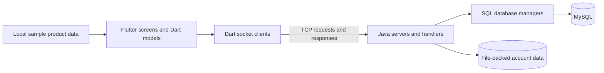

# Advanced Programming Shopping Application

**Flutter/Dart interfaces · Java socket services · SQL/MySQL persistence**

A shopping-application coursework project covering product browsing, accounts, carts, and client–server communication. The Flutter interface includes Persian text and a right-to-left layout. Java server and database code explores socket communication and persistence alongside the interface work.

Part of [Armin Mashhadi Ebrahim's](https://github.com/ARSHMINGHM) Advanced Programming coursework portfolio.

[Explore the code](docs/CODE_MAP.md) · [Setup and implementation notes](docs/SETUP.md)

## Project at a glance

| Area | What is in the repository |
| --- | --- |
| Interface | Flutter/Dart screens with Persian content and right-to-left layout |
| Shopping | Product listings, categories, product details, favorites, and cart views |
| Accounts | Login, sign-up, and profile-editing screens |
| Communication | Dart socket clients and Java TCP server/handler implementations |
| Persistence | Java SQL database managers for MySQL, plus a file-backed account implementation |
| Development stage | Coursework source containing several implementation iterations |

The repository documents the implementation work. A fresh end-to-end build and demo have not yet been verified; the [setup notes](docs/SETUP.md) identify the configuration and source issues that need to be resolved first.

## Component overview

This diagram maps the components present in the source. The server variants and local sample-data path represent different implementation iterations; they have not been verified as one integrated runtime.

## Where to start reading

- [Application entry point](lib/main.dart): application setup, routes, and layout direction.
- [Home and product cards](lib/Home/Home.dart): product browsing interface.
- [Cart](lib/Cart/Cart.dart): cart interface and item presentation.
- [Account socket client](lib/clientSocket.dart) and [product socket client](lib/ProductClientSocket.dart): Dart networking code.
- [Product database manager](lib/Server/ProductDatabaseManager.java): prepared statements and SQL operations.
- [Combined server entry point](lib/Server/MainServer.java): Java socket listeners and handler dispatch; see the known source issues before building.

The [code map](docs/CODE_MAP.md) covers the remaining screens and server variants.

## Technologies

- **Frontend:** Flutter and Dart; the manifest declares Dart SDK `^3.5.3`.
- **Backend source:** Java sockets, threads, and Gson-based JSON handling.
- **Database source:** JDBC/SQL operations targeting MySQL; the Flutter manifest also declares `mysql1`.
- **UI packages:** `cupertino_icons` and `convex_bottom_bar`.

Platform folders are included, but their presence does not establish a tested release for every platform. The current raw TCP client code also needs attention before a browser deployment.

## Working with the project

Read [Setup and implementation notes](docs/SETUP.md) before trying to run it. These explain the Flutter checks, backend dependencies, server ports, missing database schema, and source inconsistencies. There is not yet a verified single-command setup.

## Next improvements

- Establish one supported client/server configuration and reproducible backend build.
- Add the database schema and synthetic seed data.
- Move machine-specific settings into portable configuration.
- Replace the starter counter test with tests for the actual application.
- Capture real screenshots and a short demo after validating the complete flow.

This documentation update describes the existing coursework; the items above remain development work.
